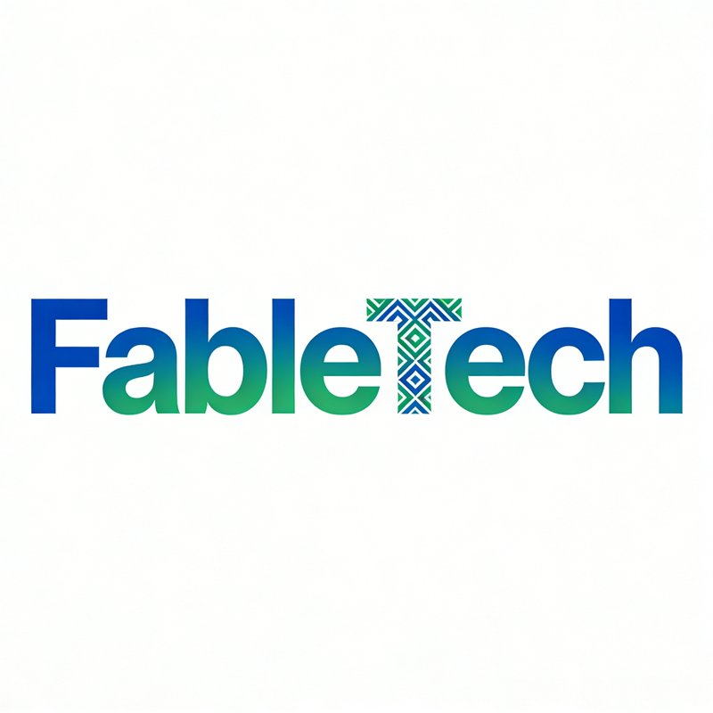

# FableTech Browser

<p align="center">
  
</p>

<p align="center"><b>面向中国出海团队的免费自托管指纹浏览器</b></p>
<p align="center">海外社媒账号注册 / 推广 / 维护 + Outlook 邮箱注册的一体化工具</p>

把 Multilogin / AdsPower 的档案管理体验，装进一个**完全免费、数据不出本机、引擎可插拔**的便携应用里。

---

## 为什么做 FableTech

开源生态里有顶级的指纹引擎（Camoufox / CloakBrowser），商业产品里有成熟的多档案管理形态，但两者之间存在空白：

- **开源引擎 ≠ 可用产品**：Camoufox 是 API/库，没有档案管理 GUI、代理池、Cookie 仓、自动化调度
- **商业产品贵且数据上云**：$99~$399/月，档案/Cookie 同步到厂商云端
- **FableTech 填补空白**：自研产品外壳（MIT，100% 自有）+ 可插拔引擎层（主引擎免费开源）

## 核心特性（v1.0）

| 模块 | 能力 |
|---|---|
| 档案管理 | 档案级指纹（种子持久化，跨会话恒定）、三引擎可选、一键启动/进程管理 |
| 指纹引擎 | **Camoufox**（主，Firefox C++ 级注入，免费）/ CloakBrowser（可选增强）/ Patchright-Chromium（备选） |
| 指纹生成 | BrowserForge 统计分布，保证 UA/屏幕/GPU/时区内部一致 |
| 代理池 | HTTP/SOCKS5 批量导入、连通测试、出口地理识别（自动匹配时区/locale）、凭证加密 |
| Cookie 仓 | Netscape/JSON 导入导出、AES-256-GCM 本地加密 |
| 自动化 | Recipe 步骤机 + 人工介入点（CAPTCHA/短信验证），内置 Outlook 注册、X/TikTok 发帖、账号巡检 |
| 调度器 | 定时/间隔任务、并发控制、失败重试、失败截图 |
| 安全 | 主密码 → scrypt → AES-256-GCM；纯本地、零遥测 |
| 交付 | win-x64-portable 单包，解压即用 |

## 快速开始

### 便携版（推荐）

1. 下载 `FableTech-1.0.0-win-x64-portable.zip`，解压到任意目录（建议非系统盘、路径无中文更稳）
2. 双击 `FableTech.exe`
3. 首次启动：设置**主密码**（遗忘 = 数据不可恢复，请妥善保管）
4. 设置页 → 「安装运行时组件」（自动安装 camoufox/playwright 等引擎依赖）
5. 代理页导入代理 → 档案页新建档案（选引擎、绑代理）→ 一键启动

### 开发模式

```bash
pip install -r requirements.txt -r requirements-runtime.txt
python -m fabletech            # GUI
python -m fabletech --help     # CLI
```

### CLI 示例

```bash
python -m fabletech create-profile --name "IG-01" --platform instagram --proxy-id abc123
python -m fabletech launch --profile <id>
python -m fabletech run-recipe --profile <id> --recipe outlook_register --params params.json
```

## 文档

- [01 开源指纹浏览器调研](docs/01-开源指纹浏览器调研.md) —— 9 个主流开源仓库逐一分析
- [02 对比分析矩阵](docs/02-对比分析矩阵.md) —— 十二维横向对比与选型决策
- [03 产品方案](docs/03-产品方案.md) —— 场景需求、功能清单、合规 SOP
- [04 架构设计](docs/04-架构设计.md) —— 引擎抽象、数据模型、安全设计
- [05 开发任务书](docs/05-开发任务书.md) —— 实现规格与红线
- [06 使用/操作手册](docs/06-使用操作手册.md) —— 安装、档案、代理、Outlook 注册实操、FAQ
- [07 维护手册](docs/07-维护手册.md) —— 备份恢复、引擎更新、故障排查、安全审计
- [08 GeekezBrowser 调研与借鉴](docs/08-GeekezBrowser调研与借鉴.md) —— 同类产品分析、v1.1 借鉴路线

**当前版本：v1.0.1**（v1.0.0 + GUI 启动修复 + Hysteria2/AnyTLS 支持 + 打包修复）

## 技术栈

Python 3.11+ · CustomTkinter · SQLite · cryptography(AES-256-GCM) · BrowserForge · Camoufox(MPL-2.0) · Patchright(Apache-2.0) · PyInstaller

## 合规声明

FableTech 是隐私与安全工具，仅供团队管理**自有账号**的营销运营使用。使用者需遵守目标平台服务条款与当地法律；禁止用于欺诈、垃圾信息或规避金融/政府类风控。主密码与账号数据仅存本机，请自行做好备份。

## License

MIT（FableTech 自研部分）。引擎依赖各随其许可证：Camoufox MPL-2.0、BrowserForge/Patchright Apache-2.0、CloakBrowser 二进制遵循其商业条款（不预装、不再分发）。
